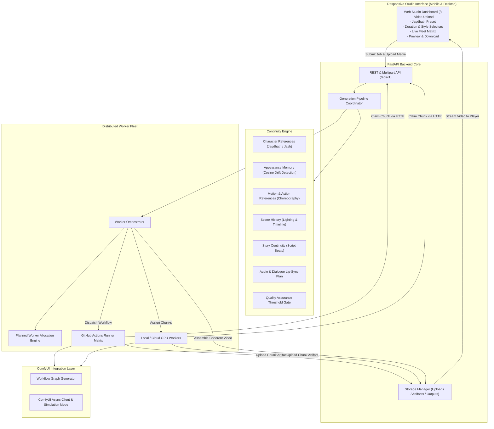

# FreeCloud AI Studio

> **AI-Powered Anime Video Generation Platform with Distributed Worker Orchestration and Continuity Preservation.**

FreeCloud AI Studio is an engineering foundation for transforming live-action footage or original narrative scripts into coherent anime-style video.

The flagship benchmark project is recreating iconic scenes from the Indian television serial **Jagdhatri** in anime style, preserving:
- **Character Identities & Appearances**: Distinct facial features, turnarounds, and attire palettes for Jagdhatri (JAS) and Jash.
- **Action & Movement Sequences**: Original martial arts choreography, disarms, and tactical pursuit sequences.
- **Facial Expressions & Gestures**: Resolute investigative looks, subtle expressions, and authentic demeanor.
- **Scene Order & Continuity**: Temporal coherence across shots, camera transitions, and lighting states.
- **Character Voices & Audio**: Vocal timbre consistency and dialogue lip-sync alignment.
- **Single Coherent Output**: Assembling distributed render chunks into one unified video.

---

## Architecture Overview



---

## Planned GitHub Actions Worker Allocation

The orchestrator dynamically partitions generation tasks and provisions workers according to the target duration schedule:

| Video Duration | Target Worker Count | Target Chunk Duration | Chunks Created |
| :--- | :--- | :--- | :--- |
| **1 minute** | **4 workers** | ~15.0 seconds | 4 chunks |
| **2 minutes** | **5 workers** | ~15.0 seconds | 8 chunks |
| **3 minutes** | **6 workers** | ~15.0 seconds | 12 chunks |
| **5 minutes** | **7 workers** | ~15.0 seconds | 20 chunks |
| **10 minutes** | **8 workers** | ~15.0 seconds | 40 chunks |
| **15 minutes** | **10 workers** | ~15.0 seconds | 60 chunks |

> [!NOTE]
> These allocations represent target design allocations, not verified performance guarantees. Runners do not assume shared memory, GPU, or local storage. All chunk data, character references, and artifacts are transferred via explicit HTTP APIs.

---

## Project Structure

```
FreeCloud-AI-Studio/
├── backend/
│   ├── api/                     # REST API routers (jobs, workers, continuity, upload)
│   ├── continuity/              # Continuity Engine modules (identity, motion, audio, quality)
│   ├── generation/              # Pipeline orchestration & AI model registry
│   ├── storage/                 # Media persistence & artifact management
│   ├── workers/                 # Worker orchestration, allocation, protocol & dispatchers
│   ├── config.py                # Environment configuration & paths
│   └── main.py                  # FastAPI application entrypoint
├── comfyui/
│   ├── client.py                # ComfyUI async REST/WebSocket client & simulator
│   └── workflow_builder.py      # Programmatic ComfyUI node graph generator
├── workflows/
│   ├── anime_video_generation_v1.json  # AnimateDiff baseline workflow
│   └── jagdhatri_scene_transfer.json   # IP-Adapter + ControlNet transfer graph
├── frontend/
│   ├── css/style.css            # Responsive dark studio theme (mobile touch optimized)
│   ├── js/app.js                # Studio controller & live polling
│   └── index.html               # Semantic dashboard with video player & controls
├── github/
│   ├── workflows/worker_runner.yml     # GitHub Actions worker matrix workflow
│   └── worker_entrypoint.py            # Standalone runner entrypoint script
├── docs/
│   ├── architecture.md          # In-depth system architecture
│   ├── continuity_engine.md     # Continuity Engine design & math
│   ├── worker_orchestration.md  # Worker allocation & communication protocol
│   └── setup_guide.md           # Setup & operator guide
├── tests/                       # Comprehensive pytest suite (20/20 passing)
├── data/                        # Runtime storage (uploads, artifacts, outputs, characters)
├── requirements.txt             # Lightweight Python dependencies
├── .env.example                 # Configuration template
└── README.md
```

---

## Milestone 1 Implementation Status

### Completed & Fully Verified
- [x] **FastAPI Backend Core**: Complete asynchronous REST API with CORS, health diagnostics, and OpenAPI documentation.
- [x] **Responsive Mobile-Friendly Studio Dashboard**: Modern dark-theme UI with Android mobile touch support (min 48px touch targets, fluid single-column layout on viewports <960px).
- [x] **Jagdhatri Preset**: One-click preset populating original narrative cues, character identity models, and action choreography.
- [x] **Worker Allocation Engine**: Exact mapping of duration to planned worker counts (1m->4, 2m->5, 3m->6, 5m->7, 10m->8, 15m->10).
- [x] **Shared-Nothing Worker Protocol**: Complete registration, task lease, heartbeat, artifact upload, and failure retry handling over HTTP.
- [x] **GitHub Actions Workflow Matrix**: Safe, rate-limit compliant workflow running up to 10 parallel runners with graceful idle exit.
- [x] **Continuity Engine Interfaces & Modules**: Character references, cross-shot appearance memory with cosine drift calculation, motion reference registry, scene lighting history, script beat parsing, viseme audio sync, and quality threshold checking.
- [x] **ComfyUI Integration Interfaces**: Workflow graph builder and offline-safe async client.
- [x] **Automated Test Suite**: 20/20 tests passing in pytest covering workers, continuity, storage, API, and ComfyUI.

### Foundation State & Next Steps (Milestone 2+)
> [!IMPORTANT]
> In accordance with project requirements, heavyweight multi-gigabyte AI model weights (AnimateDiff, SDXL, DWPose, IP-Adapter checkpoints) have **not** been downloaded during this initial milestone.
> The platform currently uses modular interfaces and validated simulation/protocol fallbacks. Full distributed GPU inference and production-grade video generation will be connected in Milestone 2 once compute runners with dedicated GPUs are provisioned.

---

## Quickstart

### 1. Run the Server
```bash
cd FreeCloud-AI-Studio
python3 -m uvicorn backend.main:app --host 0.0.0.0 --port 8000 --reload
```
Open **[http://localhost:8000/](http://localhost:8000/)** in your browser.

### 2. Run Tests
```bash
PYTHONPATH=. python3 -m pytest -v
```

### 3. Run a Local Worker
```bash
python3 github/worker_entrypoint.py --backend-url http://localhost:8000 --worker-id worker_01
```

---

## License
MIT License. FreeCloud AI Studio — 2026.
