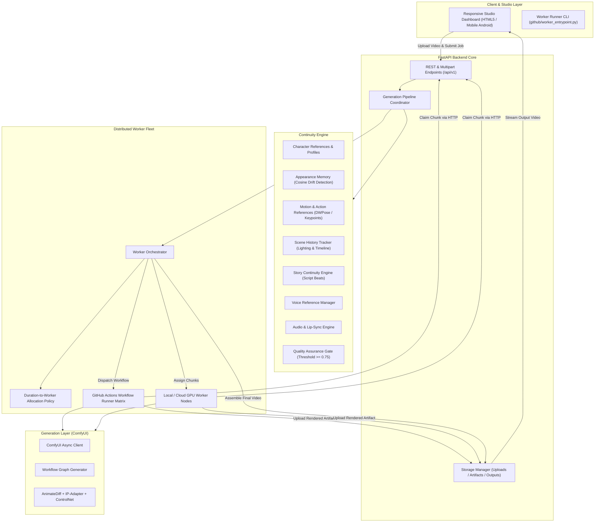

# FreeCloud AI Studio — System Architecture

## 1. Overview & Vision

**FreeCloud AI Studio** is a modular platform engineered to convert live-action video footage or structured story prompts into coherent anime-style video.

The primary target benchmark for this system is recreating scenes from the popular Indian TV serial **Jagdhatri**, preserving:
1. **Character Identities & Appearances**: Distinctive features of Jagdhatri Sanyal Mukherjee (JAS) and Swayambhu Mukherjee (Jash).
2. **Action & Movement Sequences**: Martial arts choreography, weapon disarms, tactical pursuit, and high-intensity stunts.
3. **Facial Expressions & Gestures**: Sharp investigative gaze, subtle emotional cues, and authoritative presence.
4. **Scene Order & Continuity**: Temporal coherence across camera cuts, shot transitions, and environment lighting.
5. **Character Voices**: Timbre embeddings and tonal consistency across dialogues.
6. **Audio Synchronization**: Dialogue viseme alignment and lip-sync synchronization.

---

## 2. Layered Architecture

### A. Presentation Layer (`frontend/`)
- Pure, dependency-free responsive dashboard built with semantic HTML5, CSS3 Grid/Flexbox, and modern JavaScript.
- Engineered for full compatibility on Android mobile devices (touch targets >= 48px, single-column fluid stacking on viewports <960px).
- Provides live job progress tracking, visual worker matrix status cards, continuity diagnostics, and an HTML5 coherent video preview player.

### B. Application & API Layer (`backend/api/`)
- High-performance asynchronous API using **FastAPI** and **Pydantic v2**.
- Structured into modular route domains:
  - `/api/v1/jobs`: Job creation, lifecycle tracking, video streaming, cancellation.
  - `/api/v1/workers`: Registration, heartbeat, chunk lease, artifact upload, error reporting.
  - `/api/v1/continuity`: Character profile registries, motion sequence queries, script beat parsing.
  - `/api/v1/upload`: Source video validation and worker allocation queries.

### C. Worker Orchestration Layer (`backend/workers/`)
- Manages temporary worker nodes (such as ephemeral GitHub Actions runners).
- Enforces an explicit HTTP contract: does not assume shared memory, shared GPU, or shared filesystem.
- Automatic chunk leasing with timeout recovery, exponential backoff retries, and heartbeats.

### D. Continuity Engine (`backend/continuity/`)
- Manages character identity locks, motion preservation, scene lighting coherence, and voice/audio sync.
- Pre-seeded with Jagdhatri serial character profiles (`jagdhatri_main`, `jash_lead`).
- Provides extensible interfaces ready for deep-learning models (ArcFace/InsightFace, DWPose, AnimateDiff, SadTalker, CosyVoice).

### E. ComfyUI Generation Interface (`comfyui/` & `workflows/`)
- Programmatic construction of ComfyUI execution graphs.
- Decoupled from physical ComfyUI servers with automatic offline simulation fallback.
- Pre-configured workflow JSON templates integrating AnimateDiff, IP-Adapter, and ControlNet.
