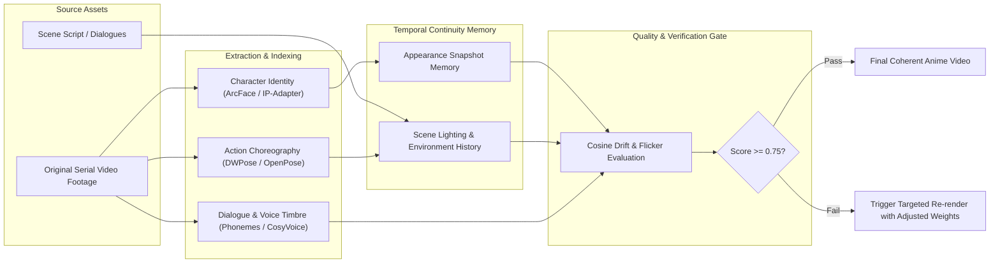

# Continuity Engine Specification

## 1. Objective

The **Continuity Engine** solves the fundamental challenge of generative video models: maintaining visual, spatial, vocal, and narrative consistency across cuts, shots, and distributed render chunks.

For our primary project—recreating scenes from the Indian television serial **Jagdhatri** in anime style—the engine provides dedicated modules for character identity, action choreography, and audio-dialogue synchronization.

---

## 2. Component Architecture

### A. Character References (`backend/continuity/character_refs.py`)
Maintains static canonical profiles containing:
- Multi-angle turnaround references (front, 3/4 profile, profile).
- Physical traits (hair styles, distinctive jewelry, facial bone structure).
- Attire palettes (e.g. Jagdhatri's tactical navy gear vs. traditional red & gold saree).
- LoRA and IP-Adapter triggers (`jagdhatri_anime_v1`, `jash_anime_v1`).

### B. Character Appearance Memory (`backend/continuity/character_memory.py`)
Tracks dynamic appearance snapshots across the temporal sequence of shots:
- Records appearance embeddings per scene.
- Computes cosine distance against baseline reference:
  $$\text{drift} = \frac{1 - \cos(\mathbf{e}_{\text{ref}}, \mathbf{e}_{\text{curr}})}{2}$$
- Detects gradual appearance drift when chunks are distributed across different worker runners.

### C. Motion & Action References (`backend/continuity/motion_refs.py`)
Preserves the choreographic essence of Indian action serials:
- Tracks martial arts sequences (e.g., defensive blocks, weapon disarms, tactical rolls).
- Encodes camera kinematics (dolly zoom, whip pans, tracking steadicam).
- Maps scene intervals to skeletal keypoint coordinate files.

### D. Scene History Tracker (`backend/continuity/scene_history.py`)
Ensures lighting and environmental continuity between sequential shots:
- Tracks time of day, interior/exterior status, and primary color palettes.
- Validates palette overlap between adjacent scenes to prevent abrupt lighting discontinuities.

### E. Story Continuity Engine (`backend/continuity/story_continuity.py`)
Parses scripts or prompts into structured narrative beats:
- Automatically detects dialogue attribution (`Character: Dialogue text`).
- Classifies scene emotional tone (`high_action`, `mysterious_tense`, `warm_domestic`).

### F. Voice References & Audio Sync (`backend/continuity/voice_refs.py` & `audio_sync.py`)
- Stores speaker timbre references and vocal profiles.
- Generates aligned viseme timelines (`AA`, `O`, `MBP`, `REST`) for mouth shape animation and lip-sync synchronization.

### G. Quality Check Gate (`backend/continuity/quality_check.py`)
Evaluates multi-modal continuity scores:
- **Identity Consistency Score**: Target $\ge 0.75$.
- **Motion Fidelity Score**: Target $\ge 0.65$.
- **Temporal Flicker Score**: Target $\le 0.35$.
- **Audio Sync Confidence**: Target $\ge 0.75$.
- Emits specific remediation recommendations if thresholds are violated.
