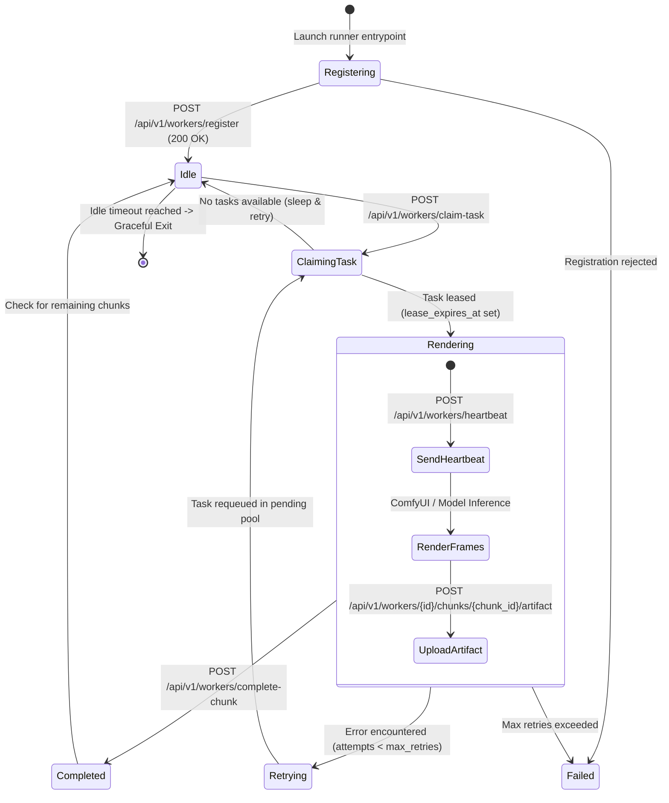

# Distributed Worker Orchestration Architecture

## 1. Planned Worker Allocation Policy

FreeCloud AI Studio distributes rendering workloads across temporary worker runners (such as GitHub Actions jobs) based on the target video duration:

| Duration | Target Worker Count | Target Chunk Breakdown | Target Chunk Duration |
| :--- | :--- | :--- | :--- |
| **1 minute** | **4 workers** | 4 chunks | ~15.0 seconds |
| **2 minutes** | **5 workers** | 8 chunks | ~15.0 seconds |
| **3 minutes** | **6 workers** | 12 chunks | ~15.0 seconds |
| **5 minutes** | **7 workers** | 20 chunks | ~15.0 seconds |
| **10 minutes** | **8 workers** | 40 chunks | ~15.0 seconds |
| **15 minutes** | **10 workers** | 60 chunks | ~15.0 seconds |

> [!NOTE]
> These allocations represent target design capacities for distributed parallelism, not verified hardware performance guarantees. Actual throughput depends on runner GPU availability and model inference speeds.

---

## 2. Shared-Nothing Worker Protocol

GitHub Actions runners and ephemeral cloud nodes do not share memory, GPU contexts, or local disk space. All coordination and asset exchange occurs through explicit HTTP contracts.

### Worker Lifecycle State Diagram



---

## 3. Communication Endpoints & Contracts

### 1. Worker Registration
- **Endpoint**: `POST /api/v1/workers/register`
- **Request**:
  ```json
  {
    "worker_id": "gha-runner-fc_a1b2c3d4-1",
    "runner_type": "github-actions",
    "runner_os": "linux",
    "client_version": "1.0.0",
    "capabilities": { "gpu": false, "comfyui_ready": false }
  }
  ```
- **Response**: Returns session token and heartbeat interval.

### 2. Task Chunk Claim & Lease
- **Endpoint**: `POST /api/v1/workers/claim-task?worker_id={worker_id}`
- **Payload**: Delivers chunk metadata, exact timestamp bounds, character reference URLs, motion keypoint references, and an expiring lease window (default: 300s).

### 3. Artifact Upload
- **Endpoint**: `POST /api/v1/workers/{worker_id}/chunks/{chunk_id}/artifact?job_id={job_id}`
- **Payload**: Multipart form upload containing the rendered `.mp4` video chunk.
- **Verification**: The backend computes and matches SHA-256 checksums to verify payload integrity.

### 4. Failure Handling & Timeouts
- If a runner crashes or fails inference, it submits `POST /api/v1/workers/fail-chunk`.
- If `attempts < max_retries` (default: 2), the chunk status transitions to `RETRYING` and is immediately re-eligible for another worker to claim.
- If a runner loses network connectivity or silently terminates, the orchestrator's `clean_stale_leases()` method resets expired leases once `lease_expires_at` is exceeded.

---

## 4. GitHub Actions Safety & Usage Compliance

FreeCloud AI Studio strictly adheres to GitHub acceptable use policies:
1. **No Infinite Loops / Restart Hacks**: Runners do not trigger cyclic workflows or restart themselves to circumvent GitHub time limits.
2. **Graceful Runner Termination**: If no tasks are available in the queue for 45 seconds (`--max-idle-seconds`), the runner terminates cleanly with exit code 0.
3. **Hard Timeouts**: The workflow sets `timeout-minutes: 20` to prevent runaway compute consumption.
4. **Targeted Matrix Execution**: The workflow matrix checks `matrix.worker_index <= inputs.worker_count` so only the requested number of runners execute.
